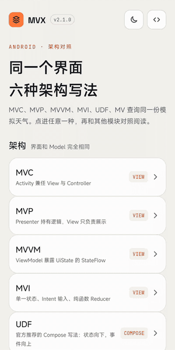
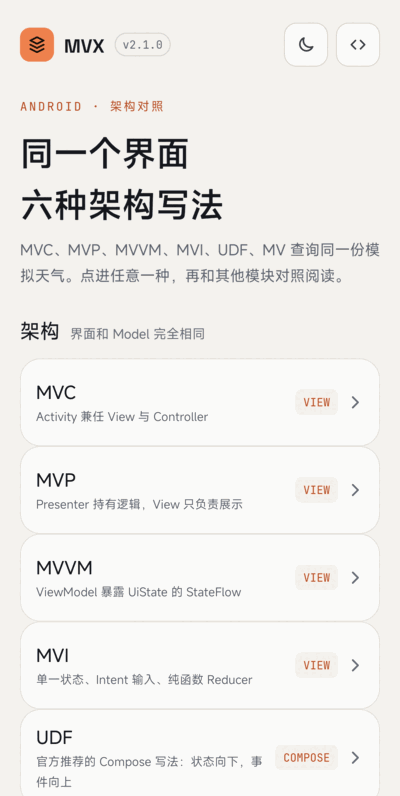
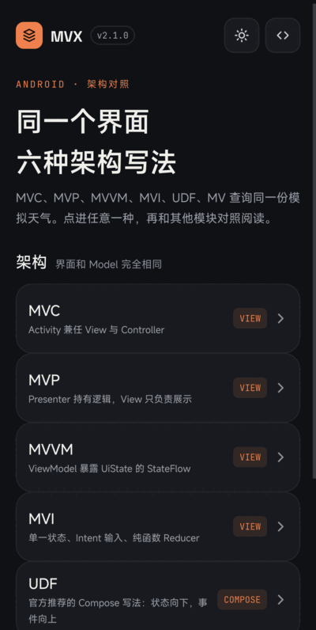
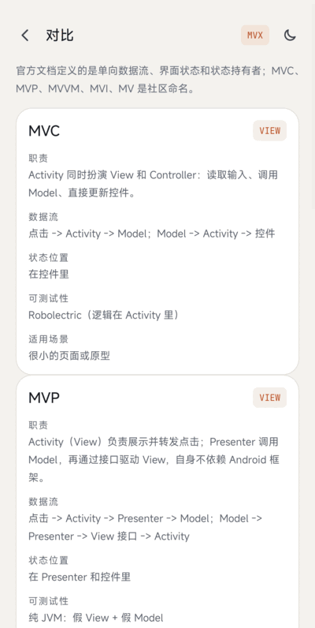
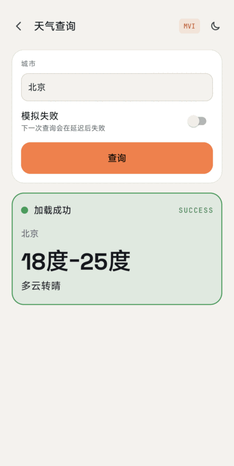
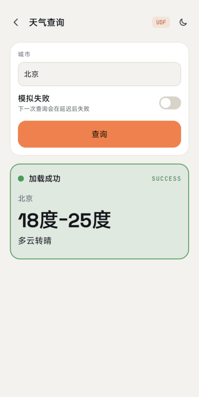
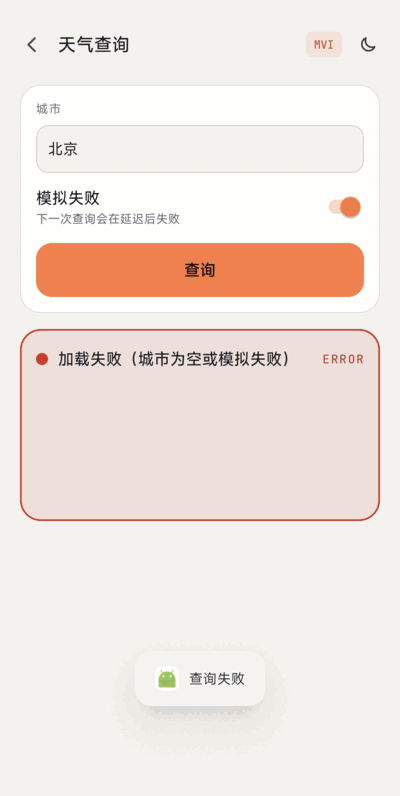
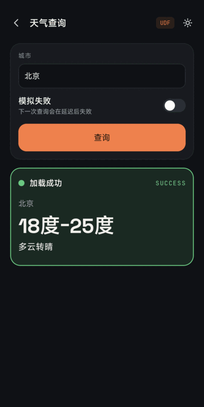

# MVX

[English](README.md)

一个界面，六种架构，**一个 App**。首页列出 MVC、MVP、MVVM、MVI、UDF、MV，点进去是**业务和外观完全一样**的同一个模拟天气查询（输入城市，点查询，先加载中，再显示结果或错误），只是写了六遍，方便并排对照阅读；另有一个「对比」页。这是演示 App，不是库。

- 版本 2.1.0，minSdk 23，targetSdk 36，Kotlin，协程。
- `mvc`、`mvp`、`mvvm`、`mvi` 用 View 体系（AppCompat DayNight）；`udf` 和 `mv` 用 Jetpack Compose，只依赖 `ui` / `foundation` / `runtime`（BOM `2026.06.01`，Compose 1.11.4）。全部模块都**不使用 Material Components，也不用 Material 3**：Compose 模块用 `foundation` 自己画出同样的卡片、按钮、开关和输入框，颜色、字体和深色模式与 View 版一致。
- 只有一个 APK，包名 `com.wx.mvx`。每种架构是一个独立的库模块，各用自己的包名：`com.wx.mvc`、`com.wx.mvp`、`com.wx.mvvm`、`com.wx.mvi`、`com.wx.udf`、`com.wx.mv`。
- 数据**纯模拟**：协程 `delay`（2 秒）后，城市为空（或打开「模拟失败」开关）则失败，否则返回固定数据，不接真实网络接口。

[**下载示例 APK**](https://github.com/venshine/MVX/releases/latest)（`MVX-sample-X.Y.Z.apk`，六种架构一个文件）

## 项目结构与怎么读代码

```
app/          com.wx.mvx    唯一可安装的模块：首页、对比页、六种架构的登记
core/         共享（View）    天气数据源、深浅色主题、颜色、字体、图标、共享布局和字符串
core-compose/ 共享（Compose） 用 foundation 画出的同一套外观，无状态的 WeatherContent
mvc/ mvp/ mvvm/ mvi/    View 体系的架构库（只依赖 core）
udf/ mv/                Compose 的架构库（只依赖 core-compose）
```

- 六个架构模块**互不依赖**，由 Gradle 保证，所以可以只读其中一个。每个模块对外只有一个入口 `MainActivity`，天气页是 `internal`。
- 对照阅读：在两个模块里打开同名文件（例如 `mvvm/.../viewmodel/WeatherViewModel.kt` 和 `udf/.../viewmodel/WeatherViewModel.kt`），或者直接看 App 里的对比页。
- 共享的 Model 和外观只有一份，在 `core` / `core-compose`，不再各抄六份。架构专属的字符串以模块名为前缀（`mvc_title`）。

## 截图

取自合并后的 App（2.1.0），设备为 Android 17 真机。



| 首页 | 首页（深色） | 对比页 |
|:---:|:---:|:---:|
|  |  |  |

| MVC | MVP | MVVM |
|:---:|:---:|:---:|
|  |  |  |

| MVI | UDF | MV |
|:---:|:---:|:---:|
|  |  |  |

| MVI 失败 | UDF 深色 |
|:---:|:---:|
|  |  |

## 同一业务的六种写法

| | MVC | MVP | MVVM | MVI | UDF（Compose） | MV（Compose） |
|---|---|---|---|---|---|---|
| View | 布局 XML + Activity | `WeatherActivity` 实现 `WeatherView` | `WeatherActivity`，按 `WeatherUiState` 渲染 | `WeatherActivity`，按 `WeatherState` 渲染并展示 `WeatherEffect` | 可组合函数：`WeatherScreen` 订阅，`WeatherContent` 无状态 | 可组合函数：`WeatherScreen` 读状态持有者，`WeatherContent` 无状态 |
| 谁处理点击 | Activity（它同时是 Controller） | Activity 转发给 `Presenter.getWeather()` | Activity 转发给 `ViewModel.query()` | Activity 把 `WeatherIntent.Query` 交给 `ViewModel.dispatch()` | `WeatherContent` 调 `onQuery`，上抛到 `ViewModel.query()` | `WeatherContent` 调 `onQuery`，上抛到 `WeatherHolder.query()` |
| 谁调用 Model | Activity，在 `lifecycleScope` 里 | `WeatherPresenter` | `WeatherViewModel`，在 `viewModelScope` 里 | `WeatherViewModel`，在 `viewModelScope` 里 | `WeatherViewModel`，在 `viewModelScope` 里 | `WeatherHolder`，在组合的协程作用域里 |
| 谁产生下一个状态 | Activity 直接改 View | Presenter 调 `WeatherView.showXxx()` | ViewModel 赋新的 `WeatherUiState` | 纯函数 `WeatherReducer.reduce(state, change)` | ViewModel 赋新的 `WeatherUiState` | 状态持有者赋新的 `WeatherUiState` |
| 状态放在哪 | View 里 | Presenter 和 View 里 | ViewModel 的 `StateFlow` | ViewModel 的 `StateFlow` 里一个不可变的 `WeatherState` | ViewModel 的 `StateFlow<WeatherUiState>` | 普通类里的 `mutableStateOf`，由 `rememberSaveable` 持有 |
| 界面怎么拿到 | 直接读 View | Presenter 推送 | `repeatOnLifecycle(STARTED)` + `collect` | `repeatOnLifecycle(STARTED)` + `collect` | `collectAsStateWithLifecycle()` | 组合时直接读 `State` |
| 一次性事件 | Activity 里 Toast | 通过 View 方法 Toast | 不用（改用状态文字） | `Effect` 走 `Channel`（Toast） | 不用（改用状态文字） | 不用 |
| 旋转后保留 | 否 | 否 | 是（ViewModel） | 是（ViewModel） | 是（ViewModel） | 已完成的结果是（Bundle）；进行中的查询否 |
| 怎么测 | Robolectric | 纯 JVM：假 View + 假 Model | 纯 JVM：假 Model | 纯 JVM：Reducer 不需要协程；ViewModel 用假 Model | 纯 JVM：假 Model | 纯 JVM：状态持有者 + 测试协程作用域 |
| 适用 | 极小页面或原型 | 不迁 Jetpack 也要可测，或维护旧 MVP | View 体系下的默认选择 | 事件多、希望所有状态变化集中审计的复杂页面 | Compose 新代码的默认选择（官方形态） | 小而自包含的可组合页面 |

数据流向：

```
MVC   点击 -> Activity -> Model            Model -> Activity -> 各个 View
MVP   点击 -> Activity -> Presenter -> Model        Model -> Presenter -> View 接口 -> Activity
MVVM  点击 -> Activity -> ViewModel -> Model        Model -> ViewModel -> StateFlow(UiState) -> Activity 渲染
MVI   点击 -> Intent -> ViewModel -> Change -> Reducer -> 新 State -> Activity 渲染     （另有 Effect -> Toast）
UDF   点击 -> onQuery -> ViewModel.query() -> Model        Model -> StateFlow(UiState) -> collectAsStateWithLifecycle -> 重组
MV    点击 -> onQuery -> WeatherHolder.query() -> Model    Model -> mutableStateOf -> 重组
```

六个模块共用同一套 Model 层（`core` 里只有一份）：`WeatherModel`（返回 `Result<WeatherInfo>` 的 `suspend` 接口）、`WeatherModelImpl(delayMillis = 2000)`（模拟数据源，测试里可换延迟或换成假实现）、数据类 `WeatherInfo`。外观也共用：同一份 `colors.xml`（浅色 + 深色）、字体、矢量图标和字符串，Compose 版通过 `colorResource`、`painterResource`、`stringResource` 读取。这里的 Compose 没有 Material 的 ripple，所以按下状态没有动画。

### 本仓库里的 MVI、UDF、MV

- **MVI**（`mvi/`，View 体系）：整个界面只有一个不可变的 `WeatherState`；唯一入口是 `dispatch(WeatherIntent)`；ViewModel 把 Intent 变成 `WeatherChange`，由 `WeatherReducer`（纯函数，测试不需要协程）算出下一个状态；失败时还会通过 `Channel` 发一个一次性的 `WeatherEffect.ShowFailure`，界面用 Toast 展示。
- **UDF**（`udf/`，Compose）：官方指南在 Compose 下描述的形态。`WeatherViewModel` 暴露 `uiState: StateFlow<WeatherUiState>`，界面用 `collectAsStateWithLifecycle()` 订阅，唯一的事件是方法调用 `query(city, simulateFailure)`。输入框和开关属于 UI 元素状态，留在可组合函数里用 `rememberSaveable`。
- **MV**（`mv/`，Compose，不用 `ViewModel`）：状态放在普通类 `WeatherHolder`（`mutableStateOf`）里，由 `rememberWeatherHolder()` 通过 `rememberSaveable` 持有。细节和限制见下一节。

### 关于 MVI 和 MV 这两个名字

MVC、MVP、MVVM、MVI、MV 都是社区对「如何组织 UI 代码」的叫法。我在下一节列出的官方页面里没有找到 **MVI** 或 **MV** 这两个名字（这些页面也没有把 MVC / MVP / MVVM 当作模式名称）。所以这里的「MVI」指社区里的那种模式（Model-View-Intent：单一状态、Intent 进入、Reducer 计算），「MV」指「状态就放在视图旁边、不用 ViewModel」；两者都不是 Android 的官方推荐。官方页面定义的是*单向数据流*、*UI 状态*、*状态持有者*（`ViewModel` 或普通类）和*事件*。

### 各自适用场景

- **MVC**：极小的页面或一次性原型。成本低，但 Activity 很快膨胀，也难测。
- **MVP**：想在纯 JVM 上测业务逻辑又暂不迁到 Jetpack，或维护已有的 MVP 代码。attach / detach 和旋转后的状态要自己处理。
- **MVVM**（`ViewModel` + `StateFlow`，View 体系）：View 体系代码的默认选择。状态在配置变化后保留，界面是单一状态对象的函数。
- **MVI**：和 MVVM 同一思路，再加更严格的约束（单一状态、单一入口、纯函数 Reducer）。页面事件多、希望所有状态变化集中在一个可测函数里时值得用；小页面用它只会多出 Intent、Change、Reducer 这些仪式。
- **Compose 下的 UDF**：Compose 新代码的默认选择，也是官方指南推荐的写法：屏幕级 `ViewModel`、`StateFlow` 形式的 UI 状态、事件用方法调用、感知生命周期的收集。
- **MV（无 ViewModel）**：小而自包含的页面，或可复用的 UI 小组件；状态不需要比页面活得更久，也没有需要保住的长任务。屏幕级状态不是官方推荐做法（见下）。

## 与官方推荐架构的关系

以下来源于 2026-11-10 阅读的原文：

- [Guide to app architecture](https://developer.android.com/topic/architecture)：关注点分离、用数据模型驱动 UI、单一数据源、**单向数据流**（状态向下流，事件向上流）；UI 层由 UI 元素和 `ViewModel` 等状态持有者组成，另有数据层。
- [UI layer](https://developer.android.com/topic/architecture/ui-layer)：不可变的 UI 状态；"The `ViewModel` type is the recommended implementation for the management of screen-level UI state with access to the data layer"，同时在某些情况下 "a simple class might suffice"；用 `StateFlow` 这类可观察持有者暴露 UI 状态，用 `collectAsStateWithLifecycle` 消费。
- [Architecture recommendations](https://developer.android.com/topic/architecture/recommendations)：「遵循单向数据流」「在收益适用时使用 AAC ViewModel」为*强烈推荐*；「在屏幕级使用 ViewModel」「可复用 UI 组件里用普通状态持有者类」和感知生命周期的收集为*强烈推荐*；「不要从 ViewModel 向 UI 发送事件」为*强烈推荐*；「暴露 UI 状态」（单个 `uiState`、`StateFlow`）为*推荐*。
- [State holders and UI State](https://developer.android.com/topic/architecture/ui-layer/stateholders)：UI 逻辑的状态持有者是普通类，自身 "do not survive `Activity` recreation"，需要时委托给 `rememberSaveable`；业务逻辑的状态持有者通常是 `ViewModel`，在 Activity 重建时保留状态。
- [State and Jetpack Compose](https://developer.android.com/develop/ui/compose/state) 与 [Architecting your Compose UI](https://developer.android.com/develop/ui/compose/architecture)：`remember` 在配置变化后不保留，`rememberSaveable` 会（存进 `Bundle`）；单向数据流与 Compose 契合。
- [UI events](https://developer.android.com/topic/architecture/ui-layer/events)：「ViewModel 事件应当总是转成 UI 状态更新」；通过 Kotlin `Channel` 向 UI 暴露 ViewModel 事件，在生产者比消费者活得久时无法保证送达。

各个 App 与它的关系：

- **UDF** 最接近官方推荐（屏幕级 `ViewModel`、`StateFlow<UiState>`、方法调用事件、`collectAsStateWithLifecycle`、屏幕下面是无状态内容组件）。
- **MVVM** 是同一思路的 View 版本（用 `repeatOnLifecycle(STARTED)` 收集）。
- **MVI** 保留了一次性 `Effect`，因为这是 MVI 模式的一部分，但这与官方「不要从 ViewModel 向 UI 发送事件」的建议**相悖**。官方的替代做法是在 UI 状态里放一个字段，界面展示后再通知清除（本仓库 MVVM / UDF 用状态文字展示失败，避开了这个问题）。请把这个 Channel 当作模式演示，而不是推荐默认写法。
- **MV** 在屏幕级状态上偏离官方推荐：指南在那里推荐 `ViewModel`。只有在指南所说「普通状态持有者足够」的场景（生命周期短的 UI 状态与 UI 逻辑、可复用组件）里才符合其表述。本演示单页上的行为，由 Robolectric 测试 `recreateKeepsAFinishedResult`、`recreateWhileLoadingDropsTheQuery` 验证：
  - Activity 重建（旋转）：已完成的结果和输入的城市会从 `Bundle` 恢复。
  - **进行中**的查询在旋转时丢失：协程作用域属于组合，随之取消；加载中时保存的状态恢复为空闲。`ViewModel` 则会保住正在运行的任务。
  - 进程被杀：只有 `rememberSaveable` 存下的内容（已完成的结果、输入的城市）会回来，没有可续接的进行中任务。
  - 进程被杀时，ViewModel 版 App 的内存状态同样丢失，除非使用 `SavedStateHandle`；这些演示都没有用。
- 本演示省略的部分：Repository / 数据层和依赖注入（指南推荐 Hilt）；这里的 Model 只有一个构造器传入的模拟数据源。导航用普通 Activity 而不是 Navigation 3，为了让六个 App 保持可比。

## MVVM 为什么用 ViewBinding 而不是 DataBinding

1.x 的 MVVM 模块用 DataBinding（XML 表达式 + `BaseObservable`），2.0 改用 ViewBinding：

- `ViewModel` + `StateFlow` 的写法不需要布局变量和表达式，Activity 渲染一个状态对象即可。ViewBinding 不支持布局变量、布局表达式和双向绑定，本演示都用不到。[View binding](https://developer.android.com/topic/libraries/view-binding)
- ViewBinding 编译更快（无需注解处理），相比 `findViewById` 类型安全、空安全（同页）。该页也说明高级布局仍可使用 DataBinding，所以这是本演示的取舍，不是说 DataBinding 被移除。
- 逻辑不写进 XML，三个模块的布局才能完全一致，这是对照阅读的前提。

## 构建与测试

```bash
./gradlew testDebugUnitTest assembleDebug lintDebug
```

- 纯 JVM 测试：MVP 的 `WeatherPresenterTest`；MVVM、UDF、MVI 的 `WeatherViewModelTest`（用 `kotlinx-coroutines-test` 断言状态序列；MVI 还检查 Effect 只送达一次）；MVI 的 `WeatherReducerTest`（纯函数，不需要协程）；MV 的 `WeatherHolderTest`（状态序列和 Saver）。
- 每个架构模块都有 Robolectric 冒烟测试（入口页和天气页的深浅色启动、主题切换、加载中、成功、城市为空和模拟失败）。`app` 模块走完整条链路：首页、进入六种架构、查询成功和失败、深浅色，以及对比页。Compose 版用 `ui-test-junit4` + Robolectric，按 `testTag` 查找节点（与 View 版的 id 同名）；UDF 和 MV 还会在空闲 / 加载中时重建 Activity；MVI 检查 Toast。
- Robolectric 固定 SDK 35（见各模块的 `robolectric.properties`）。
- Compose 1.12 及以上需要 `compileSdk 37`（[Compose compiler setup](https://developer.android.com/develop/ui/compose/compiler)）；本仓库保持 `compileSdk 36`，所以使用 BOM `2026.06.01`（Compose 1.11.4）。Compose 编译器插件 `org.jetbrains.kotlin.plugin.compose` 固定为 AGP 9.4.1 内置的 Kotlin 版本（2.2.10），见 [built-in Kotlin](https://developer.android.com/build/migrate-to-built-in-kotlin)。

## 迁移

2.0 到 2.1：原来三个独立 App（`MVC`、`MVP`、`MVVM`）改成库模块，并新增 `mvi`、`udf`、`mv` 三个；现在全部打进**一个 App**（`com.wx.mvx`，`versionCode` 3），带首页和对比页。原来的 `com.wx.mvc` / `com.wx.mvp` / `com.wx.mvvm` 不再是可安装的应用，不能从 2.0.0 的 APK 直接升级，请先卸载。天气数据源、主题、颜色和字体移到了共享模块。

从 1.x：
- Java 改 Kotlin；回调 `OnWeatherListener` 改为 `suspend` + `Result`；`Handler.postDelayed` 改为 `delay`。
- MVVM：移除 DataBinding，`BaseObservable` 实体改为不可变的 `WeatherInfo` + `StateFlow`。
- 成功 / 失败的 Toast 改成屏幕上的状态文字（更好测试，也避开一次性事件的问题）；只有 MVI 为了演示模式仍使用 Toast。
- `settings.gradle` 不再引用不存在的 `:app` 模块；各模块的 README 已删除，统一看这份。

## 维护状态

作为小型教学演示低频维护。App 已在 Android 17 真机上手动检查：首页、对比页、六个入口页和六个天气页的浅色 / 深色、查询成功和「模拟失败」。查询进行中旋转屏幕（点「查询」后竖屏转横屏再转回，间隔约 4 秒）的表现与上表一致：MV 页回到空闲状态（「就绪，点击查询」），进行中的查询丢失；UDF 页显示已完成的结果（「加载成功」，18度-25度，多云转晴）。

## 致谢

App 内置以下字体，均采用 [SIL Open Font License 1.1](https://openfontlicense.org)（协议原文见 [`core/licenses/`](core/licenses)）：
* [Space Grotesk](https://github.com/floriankarsten/space-grotesk)：Copyright 2020 The Space Grotesk Project Authors
* [JetBrains Mono](https://github.com/JetBrains/JetBrainsMono)：Copyright 2020 The JetBrains Mono Project Authors

所有图标均为自绘矢量，不使用位图素材。

## 许可证

Apache License 2.0，见 [LICENSE](LICENSE)。
