# MVX

[中文](README-CN.md)

One screen, three architectures. `MVC/`, `MVP/` and `MVVM/` are three independent Kotlin demo apps with the **same business and the same UI** (a simulated weather query: type a city, tap Query, see loading, then a result or an error), so you can read them side by side. They are demo apps, not libraries.

- Version 2.0.0, minSdk 23, targetSdk 36, Kotlin, coroutines, AppCompat DayNight (no Material Components).
- Package names: `com.wx.mvc`, `com.wx.mvp`, `com.wx.mvvm`.
- Data is **simulated** with a coroutine `delay` (2 s). An empty city fails (or turn on the "Simulate failure" switch), anything else returns fixed data. There is no real network call.

## ScreenShot

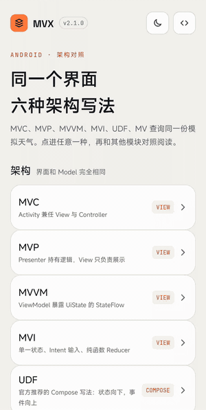

| | Home | Home (dark) | Success | Failure | Success (dark) |
|:---:|:---:|:---:|:---:|:---:|:---:|
| MVC | 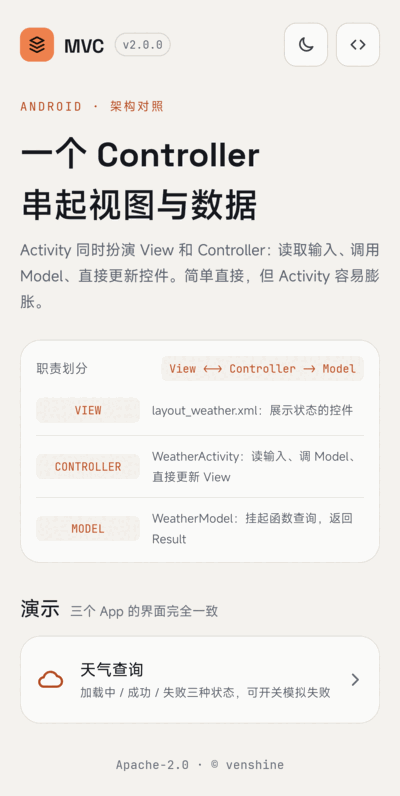 | 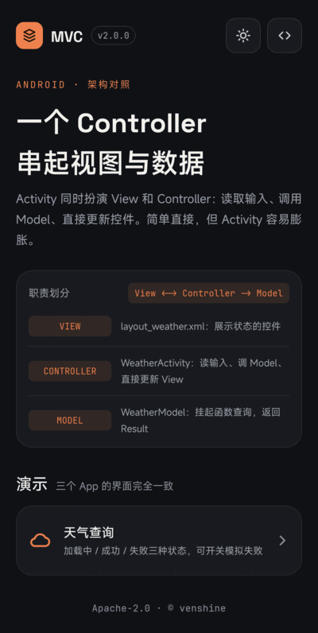 | 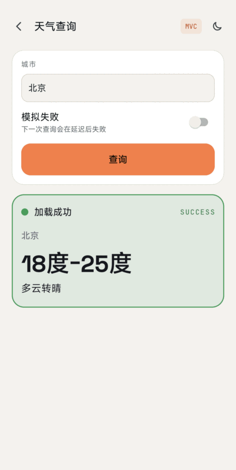 |  |  |
| MVP | 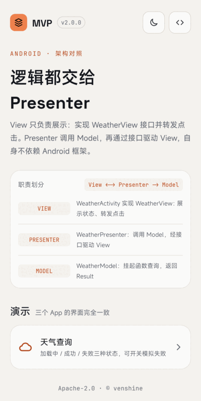 | 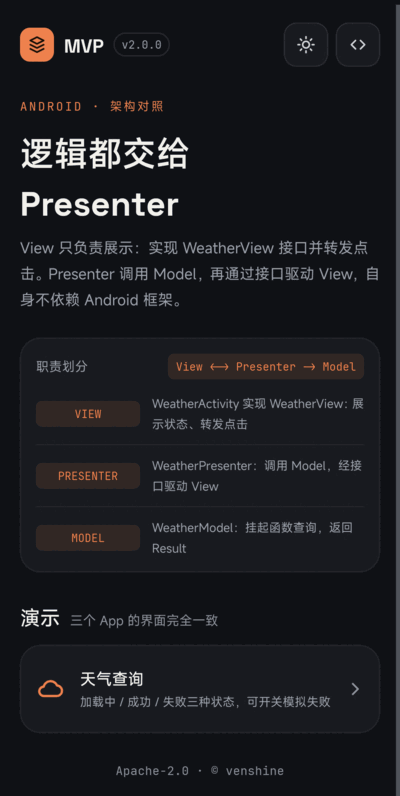 |  | 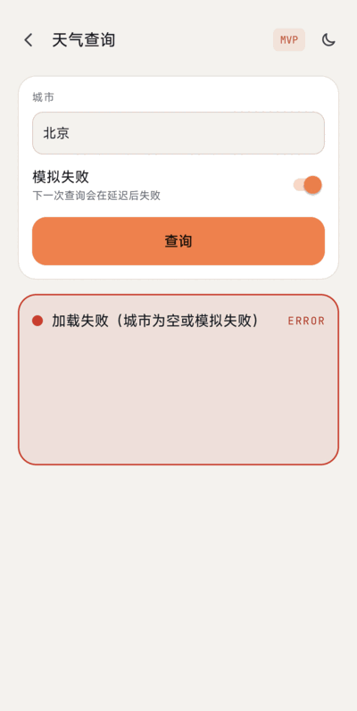 |  |
| MVVM | 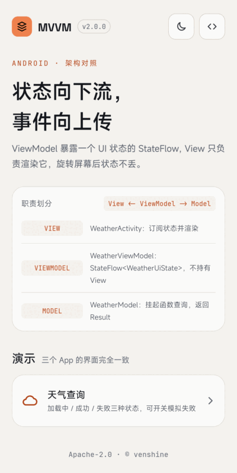 | 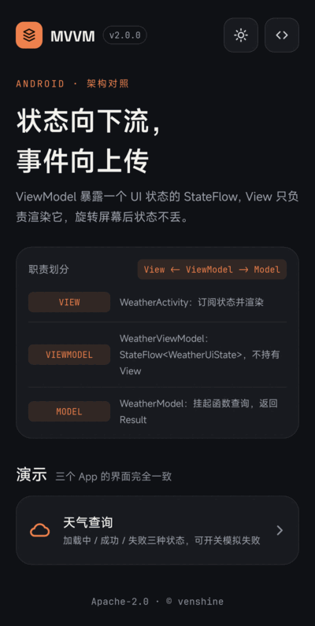 |  | 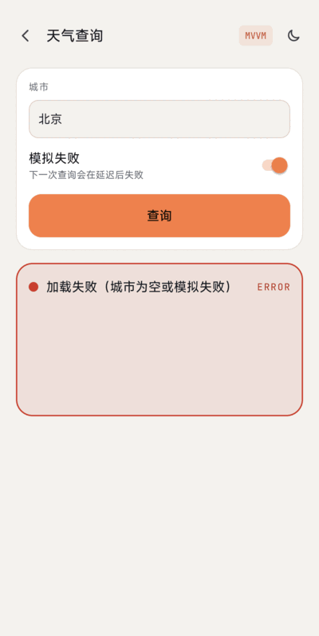 | 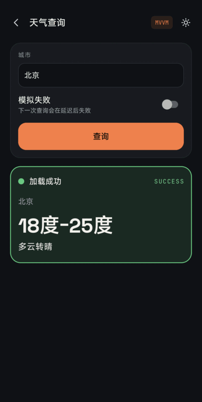 |

## The same business in three shapes

| | MVC | MVP | MVVM |
|---|---|---|---|
| View | layout XML + Activity | `WeatherActivity` implements `WeatherView` (interface) | `WeatherActivity`, renders `WeatherUiState` |
| Who handles the click | Activity (it is also the Controller) | Activity forwards to `Presenter.getWeather()` | Activity forwards to `ViewModel.query()` |
| Who calls the Model | Activity, in `lifecycleScope` | `WeatherPresenter` | `WeatherViewModel`, in `viewModelScope` |
| Who updates the UI | Activity, directly | Presenter calls `WeatherView.showXxx()` | Activity collects `StateFlow<WeatherUiState>` and renders |
| Knows about Android | everything | Presenter does not (no `Context`/`View`) | ViewModel does not hold View/Context |
| Binding | `findViewById` | `findViewById` | ViewBinding |
| Survives rotation | no (state lives in Views) | no (Presenter is recreated with the Activity) | yes (ViewModel is retained) |
| Lifecycle handling | `lifecycleScope` cancels on destroy | `attach()` / `detach()` / `destroy()` cancel the request and release the View | `viewModelScope` cancels when cleared; UI collects with `repeatOnLifecycle(STARTED)` |
| How you test it | Robolectric | plain JVM: fake View + fake Model + `kotlinx-coroutines-test` | plain JVM: fake Model + `kotlinx-coroutines-test` |

Data flow:

```
MVC   click -> Activity -> Model            Model -> Activity -> Views
MVP   click -> Activity -> Presenter -> Model        Model -> Presenter -> View interface -> Activity
MVVM  click -> Activity -> ViewModel -> Model        Model -> ViewModel -> StateFlow(UiState) -> Activity renders
```

Shared model layer (identical in all three modules): `WeatherModel` (a `suspend` interface returning `Result<WeatherInfo>`), `WeatherModelImpl(delayMillis = 2000)` (the simulated source; inject a different delay or a fake in tests) and the `WeatherInfo` data class.

### When to use which

- **MVC**: a tiny screen or a throwaway prototype. Cheap, but the Activity grows fast and is hard to test.
- **MVP**: you want the logic testable on a plain JVM without moving to Jetpack, or you maintain an existing MVP code base. You must handle attach/detach and state across rotation yourself.
- **MVVM** (with `ViewModel` + `StateFlow`): the default for new code. State survives configuration changes and the UI is a function of one state object.

## Relation to the officially recommended architecture

The official guide recommends separation of concerns, driving the UI from data models, a single source of truth and **unidirectional data flow** (state flows down, events flow up), with a UI layer of UI elements plus state holders such as `ViewModel`, and a data layer. [Guide to app architecture](https://developer.android.com/topic/architecture) The guide does not mention MVC, MVP or MVVM by name (checked on the page above); it describes principles, not a pattern name.

- The MVVM module is the closest to that recommendation: `WeatherViewModel` is the state holder, exposes an immutable `StateFlow<WeatherUiState>`, and the View only sends events (`query`) and renders state. [ViewModel overview](https://developer.android.com/topic/libraries/architecture/viewmodel): a ViewModel "caches state and persists it through configuration changes", and shouldn't hold `Context` or `Resources`.
- The guide also says to reduce dependencies on Android classes in everything but app components, which is what the Presenter does in MVP. It warns against putting all code in an `Activity`, which is MVC's weak point.
- What this demo omits: a repository/data layer and dependency injection (Hilt is recommended by the guide); the Model here is a single fake data source passed by constructor. The guide recommends Jetpack Compose for UI; this demo keeps Views to stay comparable with the 1.x version.

## Why ViewBinding instead of DataBinding in MVVM

The 1.x MVVM module used DataBinding (XML expressions plus `BaseObservable`). 2.0 uses ViewBinding:

- The `ViewModel` + `StateFlow` pattern does not need layout variables or expressions; the Activity renders one state object. ViewBinding "doesn't support layout variables or layout expressions" and two-way binding, which this demo doesn't use. [View binding](https://developer.android.com/topic/libraries/view-binding)
- ViewBinding has faster compilation (no annotation processing) and is type- and null-safe compared with `findViewById` (same page). The page says data binding still has a place for advanced layouts, so this is a choice for this demo, not a statement that DataBinding is removed.
- Keeping logic out of XML makes the MVC / MVP / MVVM layouts identical, which is the point of the comparison.

## Build and test

```bash
./gradlew testDebugUnitTest assembleDebug lintDebug
```

- MVP `WeatherPresenterTest` and MVVM `WeatherViewModelTest` are plain JVM tests (loading, success, failure sequences; MVP also covers detach and cancelling a previous query).
- Each app has Robolectric smoke tests (home and weather page in light and dark mode, theme toggle, loading, success, empty-city and simulated failure).

## Migration from 1.x

- Java replaced by Kotlin; callbacks (`OnWeatherListener`) replaced by `suspend` + `Result`; `Handler.postDelayed` replaced by `delay`.
- MVVM: DataBinding removed, `BaseObservable` entity replaced by an immutable `WeatherInfo` and a `StateFlow`.
- Toasts for success / failure are now an on-screen status line (easier to test and no one-shot-event problem).
- `settings.gradle` no longer references the non-existent `:app` module; the per-module README files were removed in favour of this one.

## Maintenance

Maintained as a small teaching demo. The three apps were run on a real device (Xiaomi 2509FPN0BC, Android 17): home page, light / dark toggle, query success, "Simulate failure" and the pages above were checked by hand; the empty-city error and rotation were not checked on the device (covered by the unit tests only).

## Credits

The three apps bundle these fonts, both licensed under the [SIL Open Font License 1.1](https://openfontlicense.org) (license texts in [`MVC/licenses/`](MVC/licenses), [`MVP/licenses/`](MVP/licenses) and [`MVVM/licenses/`](MVVM/licenses)):
* [Space Grotesk](https://github.com/floriankarsten/space-grotesk): Copyright 2020 The Space Grotesk Project Authors
* [JetBrains Mono](https://github.com/JetBrains/JetBrainsMono): Copyright 2020 The JetBrains Mono Project Authors

All icons are hand-drawn vectors; no bitmap assets are used.

## License

Apache License 2.0, see [LICENSE](LICENSE).
